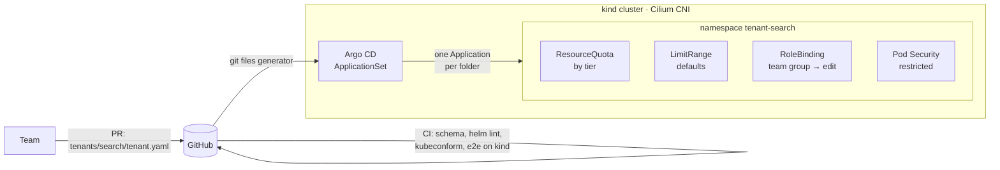

# Golden Path Platform

[](https://github.com/juliafgrimaldi/golden-path-platform/actions/workflows/ci.yaml)

A self-service, multi-tenant Kubernetes platform. A team opens a pull request with a ten-line
`tenant.yaml`; after merge it gets an isolated, policy-guarded namespace — and, if it asks for it,
metered access to a self-hosted LLM.

> Status: **milestone 1 of 8** — GitOps tenant onboarding. See the [roadmap](#roadmap).

## The problem

In most companies a new environment means a ticket, days of waiting, and a namespace that is
configured slightly differently from every other one: missing quotas, over-broad RBAC, no cost labels.
Platform teams become a bottleneck, and the inconsistency shows up later as incidents and
unattributable cloud spend.

This project turns "give my team an environment" into a reviewed pull request that always produces
the same guardrails.

## How it works



1. `tenants/<name>/tenant.yaml` is the request. Its contract is
   [`charts/tenant/values.schema.json`](charts/tenant/values.schema.json).
2. CI rejects a bad request before merge, with readable errors (wrong tier, bad email, duplicate cost center…).
3. On merge, the `tenants` ApplicationSet creates an Argo CD Application that renders
   [`charts/tenant`](charts/tenant) with that file.
4. The `tenants` AppProject limits what a tenant Application may create: only `tenant-*` namespaces
   and an allow-list of kinds.

```yaml
# tenants/search/tenant.yaml
name: search
team:
  owners: [search-lead@example.com]
  group: search-engineers
tier: small          # small | medium | large → ResourceQuota
costCenter: CC-2040  # stamped on every resource for cost attribution
llm:
  enabled: true      # opt in to the LLM gateway (milestone 6)
```

## Run it

Requirements: Docker, [kind](https://kind.sigs.k8s.io/), kubectl, Helm. The repo must be public on
GitHub, because Argo CD pulls from it.

```sh
make up      # kind + Cilium + Argo CD + all tenants
make smoke   # end-to-end checks
make down
```

Add a tenant: copy `tenants/search`, edit it, run `make validate`, open a PR.

## Roadmap

| # | Milestone | Covers | Status |
|---|---|---|---|
| 1 | Tenant onboarding via PR: ApplicationSet, quota, RBAC, Pod Security, CI + e2e | GitOps | ✅ |
| 2 | Default-deny between tenants with CiliumNetworkPolicy, Hubble walkthrough, Gateway API ingress | K8s networking | ⏳ |
| 3 | Kyverno policies with `kyverno test` in CI; cosign keyless signing + `verifyImages` | Supply chain | ⏳ |
| 4 | Terraform for VPC/IAM/Secrets Manager against an AWS emulator ([fakecloud](https://github.com/moonming/fakecloud)) | AWS networking, IaC | ⏳ |
| 5 | External Secrets Operator, one SecretStore per tenant scoped to its prefix | Secrets | ⏳ |
| 6 | vLLM (CPU, small model) behind LiteLLM; `llm.enabled` issues a key with a token budget | AI infra | ⏳ |
| 7 | Token and cost per tenant in Prometheus/Grafana; documented GPU profile for EKS | FinOps | ⏳ |
| 8 | Demo recording, architecture write-up | — | ⏳ |

## Design decisions

- [ADR 1 — A tenant is a folder in Git](docs/adr/0001-tenant-as-a-folder.md)
- [ADR 2 — Tenant namespaces are never deleted by Argo CD](docs/adr/0002-namespaces-are-never-pruned.md)
- [ADR 3 — Cilium and Argo CD are installed by the bootstrap script](docs/adr/0003-cilium-installed-by-bootstrap.md)

## Repository layout

```
bootstrap/        kind config, pinned versions, up/down/smoke-test scripts
platform/         root chart Argo CD syncs: AppProject + tenants ApplicationSet
charts/tenant/    what every tenant gets; values.schema.json is the contract
tenants/          one folder per tenant
scripts/          tenant validator, manifest renderer
docs/adr/         architecture decision records
```

## What I learned

<!-- Write this yourself as you go: surprises, trade-offs, what you would do differently. -->
