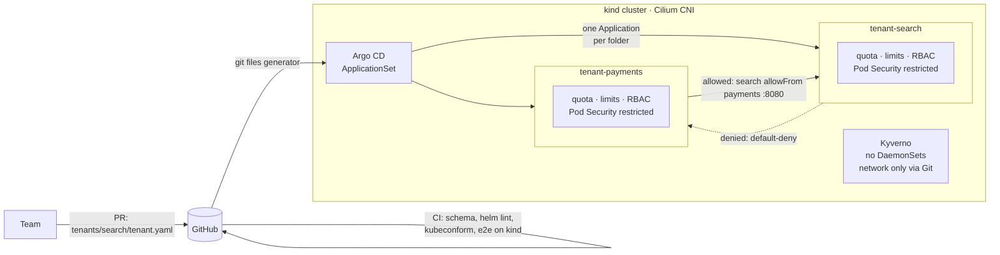

# Golden Path Platform

[](https://github.com/juliafgrimaldi/golden-path-platform/actions/workflows/ci.yaml)

A self-service, multi-tenant Kubernetes platform. A team opens a pull request with a short
`tenant.yaml`; after merge it gets an isolated, policy-guarded namespace — and, if it asks for it,
metered access to a self-hosted LLM.

> Status: **milestone 2 of 8** — tenant isolation and guardrails. See the [roadmap](#roadmap).

## The problem

In most companies a new environment means a ticket, days of waiting, and a namespace that is
configured slightly differently from every other one: missing quotas, over-broad RBAC, no cost labels,
every service able to talk to every other service. Platform teams become a bottleneck, and the
inconsistency shows up later as incidents and unattributable cloud spend.

This project turns "give my team an environment" into a reviewed pull request that always produces
the same guardrails.

## How it works



1. `tenants/<name>/tenant.yaml` is the request. Its contract is
   [`charts/tenant/values.schema.json`](charts/tenant/values.schema.json).
2. CI rejects a bad request before merge with readable errors (wrong tier, bad email, duplicate cost center,
   `allowFrom` pointing at a tenant that does not exist…).
3. On merge, the `tenants` ApplicationSet creates an Argo CD Application that renders
   [`charts/tenant`](charts/tenant) with that file.
4. The `tenants` AppProject limits what a tenant Application may create: only `tenant-*` namespaces
   and an allow-list of kinds.

```yaml
# tenants/search/tenant.yaml
name: search
team:
  owners: [search-lead@example.com]
  group: search-engineers
tier: small          # small | medium | large → ResourceQuota
costCenter: CC-2040  # stamped on every resource for cost attribution
llm:
  enabled: true      # opt in to the LLM gateway (milestone 6)
network:
  allowFrom:         # who may call US — only the receiver can grant access
    - tenant: payments
      ports: [8080]
```

### Multi-tenancy rules

| Concern | Rule | Enforced by |
|---|---|---|
| Traffic between tenants | Denied unless the **receiving** tenant lists the caller in `network.allowFrom` ([ADR 4](docs/adr/0004-receiver-grants-network-access.md)) | CiliumNetworkPolicy |
| Traffic to the internet | Only hosts in `network.egressFQDNs`, port 443 | CiliumNetworkPolicy `toFQDNs` |
| Changing network rules | Only through a PR; tenants cannot create or delete network policies | Kyverno + CODEOWNERS |
| Per-node agents | Platform-owned; tenants cannot run DaemonSets ([ADR 5](docs/adr/0005-node-agents-are-platform-owned.md)) | Kyverno |
| Privileged pods, host access | Denied | Pod Security Admission `restricted` |
| Resource usage | Quota by tier, default limits | ResourceQuota, LimitRange |

When a call is blocked, Hubble shows which flow was dropped:

```sh
cilium hubble port-forward &
hubble observe --namespace tenant-payments --verdict DROPPED
```

## Run it

Requirements: Docker, [kind](https://kind.sigs.k8s.io/), kubectl, Helm. The repo must be public on
GitHub, because Argo CD pulls from it.

```sh
make up      # kind + Cilium + Argo CD → Kyverno, policies and all tenants
make smoke   # end-to-end checks: tenants, network isolation, guardrails
make down
```

Add a tenant: copy `tenants/search`, edit it, run `make validate`, open a PR.

## Roadmap

| # | Milestone | Covers | Status |
|---|---|---|---|
| 1 | Tenant onboarding via PR: ApplicationSet, quota, RBAC, Pod Security, CI + e2e | GitOps | ✅ |
| 2 | Default-deny between tenants, receiver-granted `allowFrom`, egress FQDNs; Kyverno blocks DaemonSets and out-of-band network changes | K8s networking, policy | ✅ |
| 3 | cosign keyless signing in CI + Kyverno image verification; `kyverno test` in CI | Supply chain | ⏳ |
| 4 | Terraform for VPC/IAM/Secrets Manager against an AWS emulator ([fakecloud](https://github.com/moonming/fakecloud)) | AWS networking, IaC | ⏳ |
| 5 | External Secrets Operator, one SecretStore per tenant scoped to its prefix | Secrets | ⏳ |
| 6 | vLLM (CPU, small model) behind LiteLLM; `llm.enabled` issues a key with a token budget | AI infra | ⏳ |
| 7 | Token and cost per tenant in Prometheus/Grafana; documented GPU profile for EKS | FinOps | ⏳ |
| 8 | Demo recording, Gateway API ingress, architecture write-up | — | ⏳ |

## Design decisions

- [ADR 1 — A tenant is a folder in Git](docs/adr/0001-tenant-as-a-folder.md)
- [ADR 2 — Tenant namespaces are never deleted by Argo CD](docs/adr/0002-namespaces-are-never-pruned.md)
- [ADR 3 — Cilium and Argo CD are installed by the bootstrap script](docs/adr/0003-cilium-installed-by-bootstrap.md)
- [ADR 4 — The receiving tenant grants network access](docs/adr/0004-receiver-grants-network-access.md)
- [ADR 5 — Node-level agents are platform-owned](docs/adr/0005-node-agents-are-platform-owned.md)

## Repository layout

```
bootstrap/        kind config, pinned versions, up/down/smoke-test scripts
platform/         root chart Argo CD syncs: AppProject, tenants ApplicationSet, Kyverno, policies
charts/tenant/    what every tenant gets; values.schema.json is the contract
policies/         Kyverno ValidatingPolicies (platform guardrails)
tenants/          one folder per tenant
scripts/          tenant validator, manifest renderer
docs/adr/         architecture decision records
```

## What I learned

<!-- Draft written from the decisions in this repo. Rewrite in your own voice before sharing. -->

**Granting "edit" is broader than it looks.** I gave tenants the built-in `edit` ClusterRole and
assumed namespace isolation was done. Then I asked "what about DaemonSets?" and "what stops a team
from opening its own network?" — `edit` allows both. RBAC answers *who can touch which kinds*;
it does not express platform rules like "network changes only through review". That gap is what
an admission controller is for, and it is why Kyverno arrived a milestone earlier than planned.

**Who grants access matters more than how.** For cross-tenant traffic I compared caller-declares,
both-sides-declare and receiver-declares. The receiver owns the data, so the receiver decides —
the same reasoning as a security group. Combined with CODEOWNERS, every allowed flow is a reviewed PR
on the receiving team's folder.

**Check tool assumptions against the current release, not memory.** Two plans changed after
reading release notes: LocalStack now requires an account and token (since March 2026), which would
have broken "clone and run with one command", so the AWS side uses a token-free emulator; and
Kyverno 1.20 no longer runs `ClusterPolicy` at all, so the policies use the CEL-based
`ValidatingPolicy` API and were validated against the 1.20 CRD schema before the first run.

**Bootstrapping has a chicken-and-egg.** Argo CD cannot run without a CNI, so it cannot install
the CNI. A small script installs Cilium and Argo CD with pinned versions and hands over to one
root Application; everything after that is GitOps ([ADR 3](docs/adr/0003-cilium-installed-by-bootstrap.md)).

**Make deletion boring.** With automated prune, deleting a folder would delete a namespace full of
workloads. `Delete=false` on the Namespace turns offboarding into a deliberate step instead of a
side effect of a bad merge ([ADR 2](docs/adr/0002-namespaces-are-never-pruned.md)).

**Test the guardrails, not just the install.** The e2e job does not stop at "pods are running": it
proves payments can call search, search cannot call payments, privileged pods are rejected and a
DaemonSet in a tenant namespace is denied. If a policy silently stops working, CI goes red.
